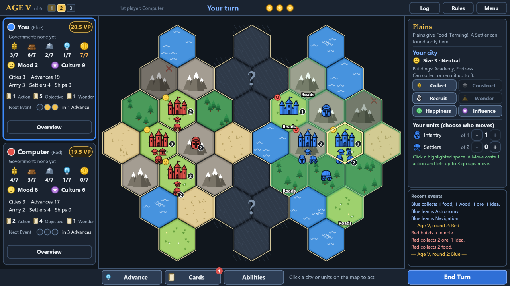

# Monumental Clash

A turn-based civilization strategy game for your web browser. You lead a young civilization against one to three computer-controlled rivals:
explore a hidden map, found and grow cities, research Advances, raise Wonders and fight for the most Victory Points before the last Age ends.

It runs completely offline and is built with [Phaser 3](https://phaser.io). Its rules adapt a published civilization board game
(called "the printed game" in this document) and follow the rulebook in [`source/rulebook.pdf`](source/rulebook.pdf).



**Contents:** [About the game](#about-the-game) · [Run it](#run-it) · [How to play](#how-to-play) · [What has been implemented](#what-has-been-implemented) · [What is still to do](#what-is-still-to-do) · [For developers](#for-developers)

## About the game

You and every computer opponent each begin with one city, one Settler, 2 Food and the Advances Farming and Mining, in your own region of a hexagonal world:
regions of four spaces each, surrounded by a ring of Sea. The world grows with the number of players, as in the printed game: 10 regions for two players, 15 for three and 18 for four.
Regions you have not seen are face-down until one of your units gets next to them.
Over a number of **Ages** you:

* explore the map and found new cities,
* collect Food, Wood, Ore, Ideas and Gold, and keep your cities happy,
* research Advances (48 in 12 categories) that unlock buildings, units and special powers,
* build Wonders and complete Objectives,
* defend yourself against the other civilizations and the Barbarians, or attack them.

When the last Age ends, the player with the most **Victory Points (VP)** wins.

* **Players:** you (Blue) against 1 to 3 computers (Red, Yellow and Green), so 2 to 4 players in all. The Barbarians (purple) are played by the game.
* **Length:** 4 to 12 Ages, 6 by default. An Age is three rounds plus a Status Phase, so a default game is 18 turns for each player.
* **A turn:** up to 3 actions, then **End Turn**.
* **Content:** 48 Advances in 12 categories (three of them are Governments), 8 Wonders, 66 Action cards (33 kinds, two of each), 26 Objective cards and 56 Event cards. The optional **Civilizations** module adds 15 peoples with four Advances of their own each, and the Obelisk and Observatory buildings.
* **Artwork:** drawn by the game itself when it starts, so there are no image or sound files to download and
  nothing to host except `docs/index.html` and `docs/game.js`.

> Monumental Clash is an unofficial fan project. It is not affiliated with or endorsed by the designers or publisher of the board game it adapts.

## Run it

You need Node.js 22 or newer (developed on Node 24).

```
npm install
npm run build
```

Then open `docs/index.html` in a current desktop browser (tested with Microsoft Edge). It works straight from disk; no web server is needed.
The build writes to `docs/` so that GitHub Pages can serve the game from there; after a change to `src/`, run `npm run build` again and reload the page.

For development, `npm start` serves the game at <http://localhost:8080> and rebuilds when a file changes.

The game saves itself after every action. Choose **Continue game** on the title screen to carry on.

## How to play

Everything below is also in the game: press **Rules** (top right of the board) or **How to play** (title screen and Menu).

### Starting a game

The title screen has six controls:

* **New game** starts a game at once. The first time, the how-to-play window opens over the map; press **Esc** to close it.
* **Continue game** appears when a saved game exists and carries on where you stopped. It shows the saved Age and round.
* **Opponents** (**-** and **+**) sets how many computer opponents the next new game has, from 1 to 3 (1 by default). With 1 computer the board is the standard one for two players; with 2 or 3 it grows to the larger boards of the printed game for three and four players. The line under the controls says how many players that makes. The choice is remembered.
* **Game length** (**-** and **+**) sets how many Ages the next new game lasts, from 4 to 12 (6 by default). The choice is remembered.
* **Civilizations** (**-** and **+**) switches the Civilizations module On (the default) or Off for the next new game. With it On every player is dealt a different people with four Advances of its own (see [Civilizations](#civilizations)); Off is the plain base game. The choice is remembered.
* **How to play** opens the rules window.

Restarting from the in-game Menu, or starting another game from the game-over window, keeps the length, the number of opponents and the Civilizations setting of the game you were playing; the title screen is where you change them.

### The goal

Have the most **Victory Points (VP)** when the last Age ends. Hover over a player's VP badge at any time to see where the points come from.

* 1 VP for every city and 1 VP for every building (Academy, Fortress, Market, Port, Temple, and with Civilizations on, Obelisk and Observatory).
* ½ VP for every Advance you have researched.
* 2 VP for every Objective card you have completed.
* 4 VP for every Wonder you have built (the Great Pyramid is worth 5). If the city of a Wonder is captured, its points are shared between the builder and the new owner; the Great Pyramid always stays with its builder.
* Bonus VP from some Events and cards.
* With Civilizations on: ½ VP for every Civilization Advance (they count as Advances), ½ VP for every Captive of the Aztecs, 1 VP for every Culture token a Celtic Druid has left under a Barbarian city and 1 VP for every Runestone of the Vikings. Phoenician Ports are worth 1½ VP each, but their Government Advances score nothing.

A tie is won by the builder of the Great Pyramid if they are among the tied players; after that, by the player with more points from cities and buildings, then Advances, Objectives, Wonders and Events (and last, with Civilizations on, the points listed above for Captives, tokens and Runestones). Players who are still level share the win. The game also ends early if any player has no cities left.

### Ages, rounds and turns

* A game is a number of **Ages**. Each Age has **3 rounds**, and in every round every player takes one turn, clockwise around the board starting with the first player. After round 3 comes the **Status Phase**.
* On your turn you may take up to **3 actions**, then press **End Turn**. Unused actions are lost. Some cards and abilities are free and do not use up an action.
* When you end your turn each computer plays its own in turn, with each move shown on the map (you can speed this up in the Menu), and then it is your turn again.

### The screen

The window is 1280×720 and scales to fit the browser.

* **Top bar:** the Age and round, who goes first, whose turn it is, your remaining actions, and the **Log**, **Rules** and **Menu** buttons.
* **Left:** a card for each player (you in blue, the computers in red, yellow and green) with Victory Points, Government, resources and storage limits, Mood and Culture tokens, cities, Advances, Army, Settlers and Ships, cards in hand and the tracker for the next Event. With 3 or 4 players your card stays in full and the computers' cards are smaller, showing the figures that matter at a glance. **Overview** lists a player's Advances, Wonders, Objectives and score; click a card to open it.
* **Centre:** the map.
* **Right:** what you have selected and what you can do with it, with a short list of recent events below.
* **Bottom:** **Advance**, **Cards** and **Abilities** open their windows, and **End Turn** ends your turn.

### What you can do on your turn

Each of these uses one action, except where noted:

* **Advance:** research a new Advance for 2 Food (Ideas or Gold can replace Food).
* **Found a city:** a Settler settles the land it stands on, if that land is not Barren or exhausted and has no enemy units on it. You can own at most 7 cities.
* **Collect:** gather resources from a city and the spaces around it. A city with a Port may also take 1 Gold or 1 Mood token from one adjacent Sea space.
* **Construct:** build an Academy, Fortress, Market, Port or Temple for 1 Food, 1 Wood and 1 Ore. Each needs an Advance first: Writing for the Academy, Tactics for the Fortress, Bartering for the Market, Fishing for the Port and Myths for the Temple. With Civilizations on you can also build an Obelisk (needs Arts) and an Observatory (needs Math) at the same price.
* **Recruit:** train Infantry (1 Food, 1 Ore), Cavalry (1 Food, 1 Wood; the city needs a Market), Elephants (2 Food; the city needs a Market), Settlers (2 Food) or Ships (2 Wood; the city needs a Port). With Civilizations on, some peoples may recruit Cavalry or Elephants in every city.
* **Wonder:** build a Wonder from your hand in a Happy city.
* **Happiness:** spend Mood tokens to raise the Mood of a city.
* **Influence:** spend Culture to win over a building in a city of another player.
* **Move:** move up to 3 groups of units to explore, attack or sail.
* **Action cards and Abilities:** play a card or use a power from the **Cards** and **Abilities** buttons (free or for one action, as it says). Mass Collection, Forced Labor and Cultural Assimilation are played together with a Collect, Construct or Influence action: tick them in that action's window.

Click a city or unit to see what it can do. Buttons that are not available say why.

### Map and units

* The board is made of regions of four spaces, surrounded by a ring of Sea: 10 regions (40 spaces) for 2 players, 15 (60 spaces) for 3 and 18 (72 spaces) for 4. Every player starts in a revealed region of their own, seated around the board; around a table of 3 or 4 your seat is chosen at random. Larger boards are scaled down to fit the window. Face-down regions (shown with "?") are revealed when one of your land units steps next to them or a Ship sails beside them. You choose how the new region is turned.
* **Infantry**, **Cavalry** and **Elephants** are your Army units. They fight, and can only move once you have researched Tactics. At most 4 Army units may share a space. You have 16 Infantry, 4 Cavalry and 4 Elephants, and Cavalry and Elephants can only be recruited in a city with a Market. When all 4 of your Elephants are already on the board, recruiting one more moves the Elephant that is farthest from the city.
* **Settlers** found cities. They cannot enter enemy spaces without Army units.
* **Ships** sail through connected Sea spaces, carry up to 2 land units each and stop when they meet an enemy Ship. To board, select land units next to your Ship and click its space. To land, select the Ship's space, set the number of Ships to 0 and click a land space beside it.
* **Barbarians** are armies and settlements (purple) controlled by the game. They appear through Events.
* **Pirates** are up to 4 black Ships that belong to nobody and are enemies of everyone. They appear through Events, never move and play no cards. A Pirate Ship blocks Collecting from the Sea space it is on and from every Sea space next to it, and blocks Trade Routes that start from or go through those spaces (it never blocks land). Your Ships cannot sail past a Pirate Ship: they stop there and fight a naval battle (you can recruit a fleet in a Port to fight the Pirates on the spot, and that fleet cannot retreat).
* To move, select your units, then click a highlighted space: **green** to move, **red** to attack, **yellow** to explore and **blue** to sail or board. One Move action lets up to 3 groups move; each group moves one space (two with Roads).
* Forest: units that enter cannot attack that turn. Mountain: units that enter must stop there. Units that fought cannot move again that turn.

### Combat

Move Army units into a space that holds enemy units or an enemy city to attack. A battle is fought in rounds until one side is wiped out or the attacker retreats. In every round:

* Both sides roll one die for every unit in the battle and add up the faces. In a land battle, every die that shows an Infantry mark adds +1, up to the number of Infantry you have in the fight, and every die that shows a Cavalry mark adds +2, up to the number of Cavalry you have in the fight. Each Elephant you have in the fight uses one die that shows an Elephant mark (the lowest one): that die is left out of the total, and the Elephant cancels one hit against its side. Elephant marks beyond the number of Elephants you have in the fight mean nothing, and nor do Elephant marks at sea.
* Every full 5 points make one hit, and each hit destroys one enemy unit. When a side has several kinds of Army unit, its owner chooses which of them are lost (Infantry first and Elephants last unless you pick otherwise; the Barbarians always lose Infantry first, then Cavalry and then Elephants).
* A Fortress gives its defender an extra die and cancels 1 hit in round 1. Warships cancel 1 hit in the first round of a naval battle.
* With Tactics you may play an Action card for its combat effect before each round.
* If both sides survive, the attacker may retreat to the space they came from.
* **Attacking Pirates:** for every Pirate Ship you eliminate you gain 1 Gold and then choose 1 Mood token or 1 Culture token, whether you win the battle or not (even after you retreat).

When all the defenders are gone, the attacking Army units take the city. The captor gains Gold equal to the city's size (+1 if it was Happy, only 1 if it was Angry); a Barbarian city is worth just 1 Gold, and beating Barbarian units earns 1 more. The captured city becomes Angry, and the old owner places a free Settler in one of the remaining cities.

Battles you take part in are shown round by round. Each round opens a battle window in which both sides' dice are rolled onto a table, one after another, and then the Combat value, the hits and the losses are explained step by step. Click **Show result** (or press Space or Enter) to skip the roll, and **Continue** (or Space or Enter again) to close the window. When the animation speed is Instant, and for fights you are not part of (computers against each other or against the Barbarians), only a short message is shown.

### Cities and Mood

* A city's size is 1 plus its buildings and Wonders. It can never exceed 5, or the number of cities you own.
* A city can collect or recruit as many things as its capacity: its size, plus 1 if it is Happy (an Angry city only 1).
* Collect, Construct, Recruit, Wonder, Happiness and Influence **activate** a city. The first activation of a city each turn is free. Every further activation in the same turn lowers that city's **Mood** one step: Happy, then Neutral, then Angry. An Angry city can be activated only once per turn and cannot Construct.
* Spend Mood tokens with the Happiness action to raise a city's Mood. Events, Influence attempts and Wonders can change Mood too.

### Advances, cards and Wonders

* **Advances:** there are 12 categories of 4. The top Advance of a category must be researched first. The three Governments (Democracy, Autocracy and Theocracy) each need a prerequisite Advance, and you can follow only one Government at a time. Every third Advance you research triggers an Event card for you; the tracker on your player card shows how many are left.
* **Action cards:** the top half is played during your turn (free, for 1 action, or together with another action); the lower half is a combat effect that needs Tactics. Some cards move units for free outside your 3 actions (Forced March, Scouting Report, Blitz Move and Sailing Fleet).
* **Objective cards:** each shows a Development goal and a Military goal. Reaching a goal earns 2 VP. Some are checked at the end of an Age, others complete during play.
* **Wonder cards** (from Engineering and Monuments): build the Wonder in a Happy city if you can pay its cost and own the required Advance. The eight Wonders are the Great Wall, Great Statue, Great Mausoleum, Great Arena, Great Library, Great Lighthouse, Great Pyramid and Great Gardens.
* **Resources:** Food, Wood, Ore, Ideas and Gold, plus Mood and Culture tokens. Food is limited to 2 until you research Storage; everything else is limited to 7.

### Events and Barbarians

* Events come from a shared deck. Most affect only the player who drew the card; some affect every player. An icon in the corner of a card is resolved first.
* **World events** (Severe Famine, Epidemic, Social Unrest, Economic Boom, Pirate Raids, Civil Revolt, Golden Age, Tax Grievances, Mercenary Influx, Feuding Warlords, Scourge of the Steppes and many more) look at the whole table, starting with the player who drew the card and going clockwise. A tie for the most or the fewest of something affects every tied player; a card for the fewest does nothing when everybody is level, and a card for the most does nothing when nobody has any. Where a card says "pay for each city, or each unpaid city suffers", you choose how many cities (and which) you pay for.
* Drought, the Plague of Locusts, the Dark Age and Non-Aggression last until the end of the round and show as a badge at the top left of the map; Mercenary Influx hires leave at the same time.
* **Barbarians** appear through Events and some Action cards. A Barbarian Settlement and an Infantry appear about two spaces from the cities of the player who drew the Event, and Barbarian armies near that player's cities step towards the nearest city and fight whatever they find there. That player chooses the order, and the route when there is a tie. Where a Barbarian city already has an Infantry, that player may place a Barbarian Cavalry or a Barbarian Elephant (there are 4 of them) there instead of another Infantry.
* Barbarian units and cities block Collecting in their space. Attack them by moving into them.
* **Pirates** arrive through Pirate Raids: the player who drew the card puts a Pirate Ship on a Sea space without player Ships (Pirate Ships may share a space), and every player with a Port loses 1 resource. When all 4 Pirate Ships are already out, the drawer first takes one off the map and may place it again. The printed game's "Pirates Spawn and Raid" icon (2 Ships, one of them next to a city of the player who drew the card when possible, then every player with a city next to any Pirate Ship loses 1 Resource, 1 Mood token or 1 Culture token, or lowers the Mood of one of those cities when they cannot pay) is in the engine, but no Event card in the deck carries it.
* A city the Barbarians capture becomes theirs, and its owner receives a free Settler in another city.

### Civilizations

With the **Civilizations** module on (the default; switch it on the title screen) every player is dealt a different **people** at random, and the seats are named after them. Each people has four **Civilization Advances**:

* A Civilization Advance costs nothing. It hangs on one ordinary Advance, its **trigger**, and you get it the moment you get the trigger, however you get it: bought, free, from a card or an Event, or when a Government cube lands on it. It needs no tracker cube and never triggers an Event. Five powers (Tribute Empire, Fighting Bands, Hunnic Tribes, Shogunate and Provinces) hang on the Government instead: you get them with the first Advance of any Government.
* Each one is worth ½ VP, like any other Advance. Some peoples add points of their own: the Captives of the Aztecs (½ VP each), the Culture tokens that Celtic Druids leave under Barbarian cities (1 VP each) and the Runestones of the Vikings (1 VP each).
* Most powers work by themselves, with a window that asks for your choice when one is needed. The ones that are an action of their own (Hegemony, Sprawling, Fighting Bands, Tribal Allies, Human Sacrifice and the Calendar) have buttons in the **Abilities** window.
* Click the name of a people on a player card to see its four Advances and which of them are active. In the **Advances** window a gold star marks an Advance that also gives you a Civilization Advance.
* The module also adds two buildings: the **Obelisk** (needs Arts), which cannot be influenced, stays in its owner's colour when the city is captured and makes a captured city count as under its owner's Cultural Influence, and the **Observatory** (needs Math), which gives you 1 Action card when you build it.

| People | Civilization Advances (the Advance that gives each one) |
|---|---|
| Aztecs | Captives (Tactics), Human Sacrifice (Rituals), Aztec Gold (Arts), Tribute Empire (a Government) |
| Babylonia | Canals (Engineering), Code of Laws (Writing), Star Catalogs (Astronomy), Ziggurats (Dogma) |
| Carthage | Warbeasts (Husbandry), Hegemony (Cartography), Pirate Allies (Navigation), Mercenaries (Draft) |
| Celts | Tribal Warfare (Tactics), Tribal Allies (Draft), Druidic Influence (Priesthood), Tribal Trade (Trade Routes) |
| China | Rice Paddies (Irrigation), Sprawling (Husbandry), Fireworks (Metallurgy), Fighting Bands (a Government) |
| Egypt | Flood Plains (Irrigation), Architecture (Engineering), Embalming (Rituals), Man God (Priesthood) |
| Greece | Formal Training (Public Education), Spartans (Draft), Hellenization (Arts), City States (Voting) |
| Huns | Nomads (Storage), Mounted Archers (Husbandry), Raiders (Tactics), Hunnic Tribes (a Government) |
| India | Indian Elephants (Husbandry), Proselytism (State Religion), Prosperity (Trade Routes), Peace and Poetry (Theaters) |
| Japan | Pottery (Storage), Horsemanship (Husbandry), Subterfuge (Tactics), Shogunate (a Government) |
| Maya | Terracing (Irrigation), Stelas (Arts), Ballcourts (Sports), Calendar (Astronomy) |
| Persia | Elephants (Husbandry), Immortals (Draft), Zoroastrianism (Priesthood), Banking (Currency) |
| Phoenicia | City Independence (Fishing), Biremes (Warships), Alphabet (Writing), Cedars and Dyes (Trade Routes) |
| Rome | Aqueducts (Engineering), Imperial Roads (Roads), Slave Economy (Bartering), Provinces (a Government) |
| Vikings | Shipcraft (Fishing), Longships (Warships), Runestones (Rituals), Marauders (Trade Routes) |

The **Civilization** window and the **Civilizations** topic of the how-to-play window say what each power does. The rules are those of the printed rulebook; the list of peoples and Advances is in `source/civ.md`.

### The Status Phase

After round 3 of every Age every player goes through the Status Phase, one after the other from the first player, step by step:

1. **Complete Objectives:** Objective cards you fulfil now are scored.
2. **Free Advance:** choose any Advance you can research, for free.
3. **Draw new cards:** 1 Action card and 1 Objective card.
4. **Raze a city** (optional): remove one of your size 1 cities for 1 Gold. You keep at least one city.
5. **Change Government** (optional): pay 1 Culture and 1 Mood token to switch to another Government you qualify for.
6. **First player:** the player with the most Mood and Culture tokens decides who goes first in the next Age (on a tie, the first of the tied players in turn order; the owner of the Great Lighthouse always decides).

After the Status Phase of the last Age the game ends. A window shows every player's final score with a breakdown, and lets you start a new game of the same length and table size, look over the board or go back to the title screen.

### Controls

* **Left-click** a city or one of your units to select it (right-click also selects). With units selected, set how many of each type go with the **+** and **-** buttons, then click a highlighted space.
* **Hover** over almost anything (resources, tokens, buildings, spaces, buttons) for an explanation. Disabled buttons say why they are disabled.
* **Esc** closes the top window or cancels your selection.
* **Log** shows the full history of the game.
* **Menu** (top right) sets the animation speed (Normal, Fast or Instant), restarts the game or goes back to the title screen. The game saves itself after every action.

### Tips for a first game

* Found more cities early. Each city is worth a point, and a city can never grow past the number of cities you own.
* Research **Storage** soon: until then you can keep only 2 Food.
* **Tactics** lets your Infantry, Cavalry and Elephants move and lets you build Fortresses.
* Watch the Mood of your cities. Activating the same city more than once in a turn makes its people unhappy, so spread the work around or keep Mood tokens ready.
* Every third Advance triggers an Event, and Events bring Barbarians, so do not leave your cities undefended.
* An Objective card is worth as much as four Advances, so read your Objectives when you draw them.

## What has been implemented

### The rules

The complete base game for two to four players (you and one to three computers), rule for rule (apart from the gaps listed under [What is still to do](#what-is-still-to-do)):

* Setup, the hexagonal maps for two, three and four players (10, 15 and 18 face-down Regions with an outer Sea ring, laid out as in the printed game's rulebook, with a home Region for every player), and exploring new Regions (you choose the orientation when the rules allow a choice).
* The Ages (6 by default, 4 to 12 if you choose), 3 rounds, 3 actions per turn, turns that pass clockwise around the table, and the full Status Phase: Objectives, free Advance, drawing cards, razing a city, changing Government and choosing the first player.
* Every main action: Advance, Found City, Collect, Construct, Recruit, Move, Influence, Increase Happiness, Wonder, Action cards.
* Resources, the Food limit, Culture and Mood tokens, city size and capacity, city Mood and the effects of activating a city more than once per turn.
* All 48 Advances in 12 categories, including the three Governments, and the 8 Wonders.
* Movement over Forest, Mountain, Roads, Ships with Navigation, carrying units, and stack limits.
* Combat with dice, hits, Fortresses, Warships, combat cards, retreats and sieges, plus capturing cities.
* Barbarians, Events and Event icons, Objective cards, the Great Pyramid tie-break and the final scoring.
* From the expansion: the **Market** building (it needs Bartering), the **Cavalry** and **Elephant** units that only a city with a Market can recruit, the **Pirate Ships**, and the optional **Civilizations** module (15 peoples with 60 Civilization Advances, and the **Obelisk** and **Observatory** buildings).
* 12 more Action cards (`source/action.csv`: 33 kinds, 66 cards in all) and 38 more Event cards (`source/events.csv`: 56 in all), for you and for the computers.

Details that are easy to get wrong are covered too, each with its own regression test:

* Port cities may collect Gold or a Mood token from the Sea; Fishing gives Mood, Navigation gives Culture, Warships and Cartography give nothing.
* Changing Government costs 1 Culture token and 1 Mood token. Dogma's free Theocracy Advance is optional, and State Religion's free Food only applies to the first Temple of a turn.
* A city never grows past size 5, nor past the number of cities its owner holds. Monuments protect Wonder cities from enemy Influence only.
* The Great Library lends one Advance for the turn (its discounts and Food limit end with the turn). The Great Mausoleum lets its owner take the top discard instead of drawing.
* Barbarians: you choose the order in which their armies advance, a Barbarian city is worth a flat 1 Gold, and beating Barbarian units adds 1 more.
* Fanaticism only places its free Infantry in a city with room for it, and the owner of overloaded Ships decides which unit is left behind after a naval battle.
* Markets, Cavalry and Elephants: a Market is built like any other building (1 Food, 1 Wood and 1 Ore, once you have Bartering, with 5 pieces per player) and the city may then recruit Cavalry (1 Food and 1 Wood each, 4 pieces, which count towards the limit of 4 Army units in a space) and Elephants (2 Food each, 4 pieces, with the same limit). Draft only makes Infantry cheaper, and recruiting Cavalry or Elephants triggers Nationalism like Infantry does. A Cavalry die face adds +2 CV, never for more Cavalry than are fighting. An Elephant uses its own die: the lowest one that shows an Elephant mark is left out of the total and cancels one enemy hit, once per Elephant in the fight; High Ground Combat blocks both the clash bonuses and the Elephants, Confusion rerolls the highest die and the Elephants are put to the lowest Elephant dice again, and Sabotaged Supplies takes 1 only from dice that count. A mixed stack lets its owner choose the casualties (the Barbarians always lose Infantry first, then Cavalry, then Elephants), and the owner of overloaded Ships leaves Settlers, Infantry, Cavalry and Elephants behind in that order unless it picks otherwise. A captured Market works for its new owner whatever its colour and without Bartering. When an opponent uses a trade route to a city with your Market you earn 1 Gold (at most 1 per trader's turn, however many Markets), and that player may skip the Market routes. Civil War makes Cavalry and Elephants desert too, while the Epidemic still takes only Infantry.
* Pirates: the 4 Pirate Ships belong to no player and are enemies of everyone. They never move, own no Advances (so no Warships bonus) and nobody plays Action cards for them. They are placed on Sea spaces that hold no player Ship, and two Pirate Ships may share a space. A Pirate Ship stops Collecting from its own Sea space and from every Sea space next to it, and stops Trade Routes that start from or pass through those spaces; land is never blocked, and a Port city may still Collect from its other Sea spaces. A Ship that moves into a Pirate Ship (or is recruited into its space) starts a naval battle, and a fleet recruited into the battle cannot retreat. For every Pirate Ship that is eliminated, win or lose, the attacker gains 1 Gold (within the limit of 7) and 1 Mood or Culture token of their choice. A Typhoon sinks Pirate Ships on deep sea like any other Ship. A Pirate is not an opponent for Objectives such as Defiance or Bold, but a sunk Pirate Ship counts as a Ship destroyed for Scavenger. The computers treat Pirate Ships as enemy Ships when they plan their Moves.
* Civilizations: the peoples and their Advances are those of `source/civ.md`, and the rules are those of the rulebook; where the two disagree the rulebook wins, and where the rulebook has no text for a power (Star Catalogs, Code of Laws, Tribal Trade, Prosperity, Alphabet, Marauders, Banking, Raiders, Aqueducts, Mounted Archers, Tribal Allies, Tribal Warfare and Fighting Bands) `civ.md` is followed. A Civilization Advance is gained at once, from your own supply, when its trigger Advance reaches you by any road (bought, free, from a card, or when a Government cube lands on it), only by its own people and only once; it takes no tracker cube and triggers no Event. Changing Government moves your cubes, so the Civilization Advances that hang on the Advances they land on come with them, and they stay if you give the Government up. Each one scores ½ VP; Captives score ½ VP each (at most 4 are kept), a Druid's Culture token 1 VP and a Runestone 1 VP, and these three only decide a tie last. Obelisk and Observatory exist only in this module. The deal is random, the same for a given seed, and leaves the map, the decks and the dice exactly as in a game without the module. Saved games from before the module open as base games.
* Civilizations, where a power was adapted: "Chemistry" in `civ.md` is Metallurgy (this game has no Chemistry), so Fireworks comes with Metallurgy. City States hangs on Voting, as in `civ.md`. Tribute Empire follows the rulebook, not `civ.md`. Hegemony is an Action, and the Ship may be a Pirate Ship you control. Human Sacrifice is the union of both texts: a Captive cancels an Event and draws again, and Captives may be spent as Food, Mood or Culture at any time on your own turn. Pottery, City States and Shogunate have no once-per-turn limit. Subterfuge can cancel Action cards played on their own (not those played together with a Collect, Construct or Influence action), is offered when the card is announced, and costs the player nothing for a cancelled card; there are no Great People cards. Hunnic Tribes steers the Barbarian movement of Events (the move icon, Incursion and Scourge of the Steppes, not the attack of Feuding Warlords) for 1 Gold or 1 Culture, once per Event, towards any adjacent land space. Tribal Allies spawn Barbarians once per turn and cancel an attack for 1 Food per attacking unit. The Mounted Archers' casualty rule changes nothing, as you always choose your own casualties. Imperial Roads is part of Roads, as in the rulebook. Pirate Allies is simplified: controlled Pirate Ships do not move with your units, Ships that share a space with Pirates do not join an attack made in place, and Events that remove units do not count them. Warbeasts apply automatically. Immortals is a blind spend before each round. Nomads cannot explore, need a Happy size 1 city, and a city that moves onto Barren or exhausted land collects nothing. Shipcraft turns one kind of unit into Ships per move. Tribal Trade routes pay Food only, Alphabet and Prosperity ask about every route, Marauders let the owner of the city choose what is lost, and Raiders measure the distance in spaces (up to 2). Hellenization allows Arts for 2 Mood, and Proselytism lets Settlers Influence enemy cities only. There is no Cultural Awe card, so a Druid's token goes only when the city is captured. Leaders and the alternate starting Regions are not in the game, so powers that mention them ignore them.
* Civilizations and the computers: they value every power when they plan (Advances, buildings, trade routes, battles and Events), play the actions of their people's Advances, and answer the windows of the others. They never use the Calendar and only rarely Sprawl, found a city with Hegemony or turn Captives into resources. Only the Fighting Bands window is limited, to 8 spaces; the Hegemony window lands the whole cargo; Aqueducts' Sanitation without an action pays with an automatic plan.
* With three or four players: Objectives that compare players (such as Science Lead and Large Army) need a lead over every opponent, Espionage asks which opponent to take from (only those with something to take are offered), a city can be captured from any player and its loser places a Settler, the Great Pyramid breaks a tie only if its builder is among the tied players, and the game ends at the next Status Phase when any player has no city left.
* The new Action cards: there are no Leaders in this game, so cards and events that mention them are adapted. Mass Collection collects from 2 more spaces (still 1 resource per space) and Forced Labor makes a Building cost 1 resource less (cities are founded by Settlers, so the settlement part needs nothing). Neutral borders are not modelled, so Cultural Assimilation (Soft Power) is simply +1 Influence range. Scouting Report ignores the Forest and Mountain penalties, and its 2-space step can neither explore nor attack. Sailing Fleet is a free Move of up to 2 groups of Ships. Free Move cards replace a Move already in progress, and Army units still need Tactics to move. Non-Aggression stops the chosen opponent's Army units from entering your spaces until the end of the round. Among the combat cards, Desperate Defense and Supply Lines work in or next to one of your cities, Boarding Party compares the final CV of both sides, Confusion rerolls the enemy's highest die, Sabotaged Supplies takes 1 from each enemy die, Financial Incentive is +1 CV for 1 Gold, Ideological Defection gives you a free Infantry when you win after destroying an enemy Infantry, and Feigned Retreat ends the battle at once. The computers play the new cards through the same rules interface as you, but never play Mass Collection, Forced Labor or Cultural Assimilation together with another action.
* The new Events: Irrigation protects against Severe Famine and Sanitation protects against the Epidemic. The Sanitation Crisis names an Aqueduct, which this game does not have, so Sanitation or Medicine protect against it. The Epidemic takes a Building from the largest city that has one (a city's size is 1 plus its Buildings and Wonders). Pirate Raids places 1 Pirate Ship (see the Pirates below) before every player with a Port loses 1 resource. Slave Revolt hits players under Autocracy, and a corrupt city cannot Collect until its next activation. Great Philosopher is a permanent extra Idea on your first Collect of each turn, on top of the icon's 2 Gold. An Event's icon is applied before its text, so Economic Boom gives the player who drew it 2 + 3 Gold. Intellectual Renaissance counts the Ideas gained during the round, Monuments of Antiquity counts built Wonders and the different Building types in your colour, and Religious Revival needs a Temple in your colour. Severe Famine and Slave Revolt do not charge cities that are already Angry. Mercenary Influx lets each player hire up to 2 Infantry for 2 Gold each in one of their spaces (with an Army unit or a city) that is next to a hostile city or foreign unit; they leave at the end of the round. Maritime Expansion moves one Ship up to 2 sea spaces (it cannot explore). Typhoon destroys Ships on deep-sea spaces (no land next to them) unless they are within 1 space of a Port's sea space. Scourge of the Steppes brings 2 Barbarian Cavalry in on the known land farthest from the largest city, at least 3 spaces from every city, so they cannot take a city on the turn they arrive, and rides them up to 2 spaces towards it. The computers do not hire Mercenaries or move Ships for Maritime Expansion.

### The computer opponents

Every computer lists the sensible actions available to it, plays each one out on a copy of the game (several times when dice
or unseen cards are involved, with everything it could not see reshuffled), and keeps the one that improves its position
most. It uses exactly the same rules interface as you do, and each one plays for itself against all the others. With the Civilizations module
on, they value the powers of their own people and weigh the Obelisk and Observatory.

### The interface

* A title screen with **New game**, **Continue game**, the **Opponents** selector (1 to 3 computers), the **Game length** selector (4 to 12 Ages), the **Civilizations** switch (On or Off) and **How to play**.
* A hexagonal map with generated terrain art and a symbol for every unit and building type, tinted with its owner's colour. Highlighted spaces (green, red, yellow, blue) show what the selected units can do. The map is scaled to fit the window, so the larger boards of three and four players are drawn a little smaller.
* Player cards (a compact card for each computer when there are three or four players), a panel for the selected city or unit, a list of recent events, the full **Log**, and an **Overview** of each civilization with its score breakdown.
* Windows for researching Advances (the computers' Advances are marked, and a gold star shows the Advances that bring a Civilization Advance), cards, Abilities, constructing and recruiting, Influence, and choosing how a newly explored region is turned.
* With Civilizations on: a **Civilization** window with the four Advances of a people and which of them are active, the civilization on every player card, the Captives, tokens and Runestones in the score breakdown, and windows for the choices the powers ask for (Hegemony, Fighting Bands, Human Sacrifice, Star Catalogs, Subterfuge and the rest).
* A round-by-round **battle** window in which the dice roll onto a table before the result is explained, and a **game over** window with a column of final scores for every player.
* Explanations on hover for almost everything, and disabled buttons that say why they are disabled.
* Moves, turn banners and battles are animated, and the animation speed can be set to Normal, Fast or Instant.
* The game saves itself after every action; **Continue game** picks it up again.
* **Rules**, a written manual for every part of the game.

### Under the hood

* The rules engine has no dependency on Phaser, so the same code runs in the game, in the tests and in computer-vs-computer simulations. A game can be started from a fixed seed, at any table size.
* Automated tests cover the rules, scoring, saving and loading, random play, computer-vs-computer games at every table size, the rule details listed above, the rules for three and four players (`test/multiplayer.test.mjs`), the Cavalry and Market rules (`test/cavalry.test.mjs`), the Elephant rules (`test/elephants.test.mjs`), the Pirate rules (`test/pirates.test.mjs`), the Civilizations module (`test/civilizations.test.mjs` for the deal, the scoring and whole games, and `test/civ-economy.test.mjs`, `test/civ-influence.test.mjs`, `test/civ-war.test.mjs` and `test/civ-actions.test.mjs` for the 60 powers), every Action card (`test/cards.test.mjs`), every Event card (`test/events.test.mjs`) and a browser test that plays through the real game window.
* Development scripts for simulations, fuzzing and screenshots (see [For developers](#for-developers)).

### Recent changes

* **Civilizations:** an optional module (on by default, with a switch on the title screen) in which every player is dealt one of 15 peoples (Aztecs, Babylonia, Carthage, Celts, China, Egypt, Greece, Huns, India, Japan, Maya, Persia, Phoenicia, Rome and Vikings) with four Civilization Advances each, 60 in all, from `source/civ.md` and the rulebook. A Civilization Advance comes free, with no tracker cube and no Event, the moment you get the ordinary Advance it hangs on, and scores ½ VP. The powers reach nearly every part of the game: Collect, Construct and city growth, Influence, Moves and Ships, trade routes, battles, Events and the Barbarians, and the cards. The **Obelisk** (Arts) and **Observatory** (Math) are new buildings, and the Aztec Captives, the Celtic Druid tokens and the Runestones of the Vikings score points of their own. The computers value and use all of it, the title screen has a switch, the player cards, the Advances window and the new Civilization window show the powers, and the in-game Rules have a Civilizations topic. Saved games from older versions still open, as games without the module.
* **Pirates:** the 4 black Pirate Ships of the Civilizations expansion. They belong to nobody and never move. Pirate Raids now puts one of them on a Sea space without player Ships before the Port owners lose their resource; the printed Pirates Spawn and Raid icon (2 Ships, then every player with a city next to a Pirate Ship loses 1 Resource, Mood token or Culture token) is in the rules engine, but no Event card carries it. A Pirate Ship stops Collecting from its own Sea space and from the Sea spaces around it, stops Trade Routes that start from or go through them, and stops every Ship that sails into it: you fight a naval battle, and for every Pirate Ship you sink you gain 1 Gold and 1 Mood or Culture token, win or lose. The Pirates have their own black symbol on the map, spawns, raids and bounties are announced and animated, you are asked what a raid takes from you and which token you want as a bounty, the in-game Rules were extended, and the computers count the Pirates as enemies.
* **More Action cards and Events:** 12 new Action cards from `source/action.csv` (66 cards in all) and 38 new Event cards from `source/events.csv` (56 in all). The Action cards add free exchanges and Moves, Collect, Construct and Influence boosts, Reinforce, Denial of Progress, Spy Network and Non-Aggression, together with a new set of combat tactics (Routing Army, Flanking Maneuver, Boarding Party, Confusion, Feigned Retreat and more). The Events affect the whole table: famines, epidemics, unrest, booms, raids, mercenaries, feuding Barbarians, steppe horsemen and others. Effects that last for the rest of the round show as badges on the map, you are asked before you pay or choose, and the in-game Rules and card windows were extended.
* **Elephants:** each player has 4 Elephants, recruited for 2 Food in a city with a Market. Elephants are Army units: they need Tactics to move, count towards the stack limit of 4 and take one of the 2 places on a Ship. In a clash an Elephant uses the lowest die that shows an Elephant mark: that die adds nothing to your total, but the Elephant cancels one hit against you. You choose which of your Infantry, Cavalry and Elephants a hit destroys. Barbarians may field Elephants too, in place of an Infantry in a city that already has one, and you are asked about them as you are about Cavalry. The battle window shows the Elephant dice that were left out, and the city windows, map symbols and the in-game Rules were extended; the computers count Elephants in their battle odds.
* **Markets and Cavalry:** research Bartering to build a Market in a city, and recruit Cavalry there (1 Food and 1 Wood). Cavalry are Army units: they need Tactics to move, count towards the stack limit of 4 and take one of the 2 places on a Ship, and each Cavalry face on the combat dice adds +2 CV. You choose which of your Infantry and Cavalry a hit destroys. Opponents who trade with your Market give you 1 Gold, and Barbarians may field Cavalry too. The battle window, city windows, map symbols and the in-game Rules were extended, and the computers know how to use Cavalry.
* **1 to 3 computer opponents:** choose the number of computers on the title screen (1 by default), for 2 to 4 players in all. The map grows with the table (10, 15 or 18 regions, from the printed game's rulebook) and is scaled to fit the window, every computer has its own colour and card, and turns, the Status Phase, Espionage, Objectives and the final scores all work for every player. Saved games from older versions still open.
* **Selectable game length:** choose 4 to 12 Ages on the title screen (6 by default). The top bar shows "AGE V of 6", restarting keeps the length, and saved games from older versions open as 6-Age games.
* **Bigger map and clearer symbols:** the hexes are a little larger, the side panels were re-flowed so the whole board still fits, and the symbols for units, buildings and Wonders were redrawn.
* **New name:** the game is now called Monumental Clash (title screen, browser tab and package name).
* **Dice roll in battles:** the battle window rolls the dice onto a table before it explains the result. Show result, Space or Enter skips the roll; Instant animation speed still skips the window altogether.

## What is still to do

### Gaps compared with the printed game

These parts of the printed game are not in Monumental Clash yet:

- [ ] **Human opponents.** Every opponent is a computer: there is no hot-seat play with several people at one screen and no online play.
- [ ] **Leaders and the alternate starting Regions** of the expansion. The Civilizations module has the peoples and their Advances, but a few of the powers are simplified (see the notes under [The rules](#the-rules)).
- [ ] **The exact printed cards.** The rulebook does not list every card, so the Action, Objective and Event cards and the Advance descriptions are original reconstructions
  written to match the mechanics in the rulebook (the newest Action and Event cards follow the short descriptions in `source/action.csv` and `source/events.csv`). They do not match the printed cards one for one.
- [ ] **The strict turn rules.** You may press **End Turn** before using all 3 actions (the rulebook says you must perform 3), so you are never forced into a pointless or harmful action,
  and a player's last city cannot be razed in the Status Phase, which would end the game by accident. A "strict rules" option could bring back the printed behaviour.

### Ideas for the future

These are suggestions, not promises:

- [ ] **Difficulty levels** for the computer opponents (easier and harder), and different play styles.
- [ ] **Sound:** effects and music. The game is silent today.
- [ ] **Better artwork and animation:** the art is simple and generated in the browser; hand-made illustrations and animated fights on the map (only the dice roll is animated today) would help.
- [ ] **Touch and small screens:** the window is a fixed 1280×720 scaled to fit, and explanations appear on hover, which touch screens do not have.
- [ ] **Several save slots**, and exporting or importing a save. There is one autosave today, kept in the browser.
- [ ] **Undo** for actions that involve no dice or hidden cards.
- [ ] **Keyboard shortcuts** for common actions. Only Esc (and Space or Enter in the battle window) are used today.
- [ ] **A guided tutorial game** in addition to the written manual.
- [ ] **Accessibility options:** a colour-blind-friendly palette and larger text.
- [ ] **Translations.** The game is English only.
- [ ] **Statistics and replays** of finished games. The Log is the only record today.

## For developers

```
src/engine   the rules, with no dependency on Phaser. Actions are generators that ask questions through prompts.
src/ai       the computer opponents
src/ui       the Phaser scenes, dialogs and drawing code
test         the automated tests and development scripts
docs         the built game (written by npm run build, and served by GitHub Pages) and the screenshot shown at the top of this file
source       the rulebook that the rules follow
```

* `npm test` runs the whole suite: rules scenarios, scoring, saving and loading, random-play fuzzing, computer-vs-computer games at every table size,
  regression tests for the rule details listed above (`test/fidelity.test.mjs`), the rules for three and four players (`test/multiplayer.test.mjs`), the Cavalry and Market rules (`test/cavalry.test.mjs`), the Elephant rules (`test/elephants.test.mjs`), the Pirate rules (`test/pirates.test.mjs`), the Civilizations module (`test/civilizations.test.mjs`, `test/civ-economy.test.mjs`, `test/civ-influence.test.mjs`, `test/civ-war.test.mjs` and `test/civ-actions.test.mjs`, which share the fixtures in `test/civs.mjs`), the Action cards (`test/cards.test.mjs`), the Event cards (`test/events.test.mjs`) and a browser smoke test. The browser test needs `npm run build` first and a Chrome or Edge install (set `BROWSER_PATH` if it is in an unusual place); it is skipped otherwise.
* `npm run simulate -- 6 1 --check` plays 6 computer-vs-computer games from seed 1 and checks the game state after every action. Add `--ages=N` (4 to 12) to change the game length, `--opponents=N` (1 to 3) to change the number of computers at the table and `--civs` to play with the Civilizations module.
* `node test/fuzz.mjs 1 50` plays 50 random games to look for rule violations (also accepts `--ages=N`, `--opponents=N` and `--civs`).
* `node test/shot.mjs out.png "?seed=7"` takes a screenshot of the built game. A numeric `?seed=` in the address starts a game with that seed straight away, without Civilizations unless you add `&civs=1`; add `&opponents=N` (1 to 3) to choose the table size, as in `"?seed=7&opponents=3"`.
* `?debug=textures` shows every generated texture.
* In the browser console `__game`, `__ctl` and `__phaser` give access to the game state, the controller and Phaser.

Browsers without a GPU (headless runs, software rendering) are slow for the first ten seconds or so because Phaser
holds back its clock while it starts up; this is not a bug and goes away on normal machines.
